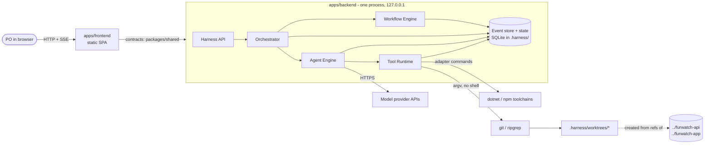

# 01 — System Architecture

**Status:** ACCEPTED. Blueprint v0.2, approved by the PO at gate 2 on 2026-11-25. Items still marked OPEN below remain open.

**Labels used in this document:**

| Label | Meaning |
|---|---|
| VERIFIED | Checked in source or on this machine |
| PROPOSED | A design choice that needs PO approval |
| OPEN | A decision not made yet (see `open-decisions.md`) |
| UNKNOWN | Not established |

Decisions are referenced as `TD-NN` (in `08-technical-decisions.md`) and `D#` (in `open-decisions.md`).

**How the blueprint is split**

| Doc | Covers |
|---|---|
| 01 (this) | Context, containers, boundaries |
| 02 | Agents |
| 03 | Workflow and orchestration |
| 04 | Tools and security |
| 05 | Data and events |
| 06 | Virtual Office |
| 07 | Roadmap |
| 08 | Decisions |

## 1. What the Harness is, and what it is not
- **Furwatch Harness** is a local-first application. It runs a hybrid AI team (BA, Architect, BE, FE, Tester and Release Manager agents, coordinated by an Orchestrator) on the PO's Windows machine.
- **The products are separate.** The team works on two **managed product repositories**, `../furwatch-api` and `../furwatch-app`. They are separate git repos, and the Harness never imports their code (`contracts.md` §4).
- **Two contexts must not be confused:**

  | Context | Who works | On what | How |
  |---|---|---|---|
  | **Building the Harness** (now) | The Claude Code team in this repo | Ownership in `agent-design.md` §2.1: BE owns `apps/backend`, FE owns `apps/frontend` | `.claude/skills`, `/fw:*` commands |
  | **Running the Harness** (later) | The Harness's own runtime agents | The product repos, through project adapters (doc 04 §5) | The Harness backend |

  The two share role definitions and standards, but not code.

## 2. Drivers and constraints

| # | Driver | Evidence | Consequence |
|---|---|---|---|
| C1 | Local-first, one user, Windows 11 | VERIFIED: `docs/discovery/README.md` | One backend process. Embedded database. Binds to 127.0.0.1. |
| C2 | Cost-conscious | PO brief | Deterministic orchestration with no LLM in control flow. Model tiering and caching (doc 02 §6). |
| C3 | Product repos contain committed secrets | VERIFIED: `backend.md` §8, `frontend.md` §4 | Secret paths are denied and all output is redacted (doc 04) |
| C4 | Starting `furwatch-api` has side effects | VERIFIED: `backend.md` §2, §4 | Product servers are disabled until D3 is resolved (TD-07) |
| C5 | `furwatch-app` can't be built from the local checkout | VERIFIED: `frontend.md` | Worktrees are created from a git ref; FE work is blocked by D1 |
| C6 | The human decides; production needs explicit approval | `CLAUDE.md` gates | Approval Center. Gate actions can't be configured away. |
| C7 | BE/FE monorepo with contract-first API | ACCEPTED (D7a): `contracts.md` | `packages/shared` is the only coupling between the two apps |
| C8 | Toolchain on this machine | VERIFIED 2026-11-25 | Installed: Node 20.20.1, corepack, git 2.55, ripgrep, Chrome, .NET SDK 10, Python 3.11. Not installed: pnpm, Docker, Java. The stack is chosen in D4 / TD-01. |

## 3. Containers
The system is one deployable backend plus a static frontend. There are no microservices and no message broker. In-process modules are enough for a single local user.



| Container | Responsibility | Detail in |
|---|---|---|
| **Harness API** | REST + SSE endpoints from `packages/shared`, the session token, Origin/Host checks | 04 §6, 05 §4 |
| **Orchestrator** | Task DAG scheduling, concurrency limits, retries, approval waits, resume | 03 |
| **Workflow Engine** | Work-item stage state machine and gate rules (deterministic, no LLM) | 03 |
| **Agent Engine** | Role profiles, context assembly, model calls, budget enforcement | 02 |
| **Tool Runtime** | Tool registry, permission checks, redaction, process supervision, worktrees | 04 |
| **Event store** | Append-only event log, state tables and projections for the UI | 05 |
| **Frontend** | Agent dashboard, Requirement Inbox, Kanban, Approval Center, Activity Timeline, Virtual Office | §5 below, 06 |

## 4. Backend structure
Modules live inside one package. Dependencies point downward only. Internal packages are split out only when a technical decision (TD) says so (`coding-standards.md` §4).

```
apps/backend/src/
  main.ts            # composition root: config, DI wiring, startup recovery (03 §6)
  api/               # routes, SSE, auth token, error mapping   -> uses all below
  orchestrator/      # scheduler, task DAG, retries, approval waits
  workflow/          # work-item state machine, gate definitions
  agents/            # agent engine: role profiles, context builder, run loop, budgets
  providers/         # model provider port + adapters (anthropic first, fake for tests)
  tools/             # tool registry + tool implementations
  permissions/       # policy engine, approvals, secret-path deny, redaction
  workspaces/        # git worktree lifecycle, branch naming
  runtime/           # process supervisor, ports, health probes, verification runner
  projects/          # adapter manifests, project registry, indexing (rg)
  events/            # event append, in-process bus, projections
  store/             # SQLite access + migrations (only module touching the DB)
  config/            # typed config, env profile loading (names only in logs)
```

**Dependency rules:**
- `api` → (`orchestrator`, `workflow`, `events`)
- `orchestrator` → (`workflow`, `agents`, `runtime`, `permissions`)
- `agents` → (`providers`, `tools`)
- `tools` → (`permissions`, `workspaces`, `runtime`, `projects`)
- Every module may use `events` and `store`.
- No module imports `api`.

## 5. Frontend structure
```
apps/frontend/src/
  app/               # router, layout, providers
  api/               # typed HTTP client + SSE client built on packages/shared
  state/             # event-fed client store (projections), query cache
  features/
    dashboard/       # agent dashboard: active runs, cost, health
    inbox/           # Requirement Inbox: PO submits requests -> BA runs
    kanban/          # work items x stages, tasks x status
    approvals/       # Approval Center: exact action/diff/command, approve/deny
    timeline/        # Activity Timeline: filtered event stream
    office/          # Virtual Office (06)
    runs/            # run detail: turns, tool calls, logs, diffs
    projects/        # managed repos, adapter status, verification results
    settings/        # providers, model per role, budgets (read), policy (read)
  components/        # shared UI primitives
```

- **Read path:** every view reads projections fed by one SSE connection (05 §4).
- **Write path:** views write only through commands in the HTTP contracts, such as `approve`, `submitRequirement` and `cancelRun`.

## 6. Shared package and workspace root
```
packages/shared/src/
  domain/      # ids, enums, state names (work item, task, run, approval)
  contracts/   # HTTP endpoints per resource: method, path, request/response schema, errors
  events/      # event envelope + event catalog schemas (05 §3)
  errors/      # the single error shape and error codes
tests/         # contract/, e2e/, fixtures/ (fixture git repos, scripted fake-provider runs)
adapters/      # project adapter manifests (furwatch-api.yaml, furwatch-app.yaml)
policy/        # permission policy files - agents can never write here
.harness/      # gitignored: harness.db, logs/, worktrees/, env/, session
```

## 7. Risks and trade-offs
| Trade-off / risk | Position |
|---|---|
| A single process is a single point of failure | Accepted for a local, single-user tool. Recovery comes from the persisted event log (03 §6). |
| SQLite allows only one writer | Writes go through `store` with short transactions. The write volume (events, logs index) suits SQLite. UNKNOWN until measured in M2. |
| A modular monolith may blur boundaries over time | The dependency rules in §4 are enforced by a lint rule from M1 |
| The Harness and the products are easy to confuse | §1 names the two contexts, and project adapters are the only path to the products |
