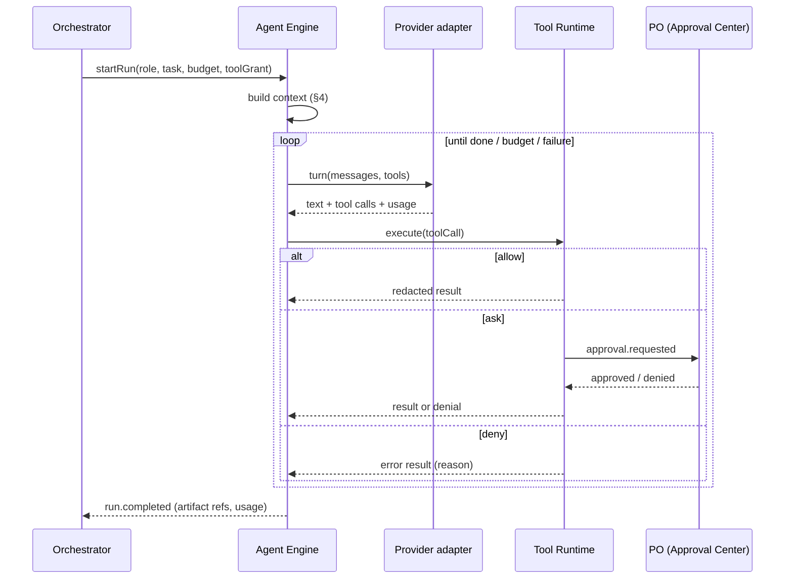

# 02 — Agent Architecture

**Status:** ACCEPTED (gate 2, 2026-11-25). Workflow stages and gates are in doc 03. Tools are in doc 04. Decisions: TD-05, TD-06, TD-10.

## 1. Roles at runtime

| Role | Purpose | Model use | Writes |
|---|---|---|---|
| **PO (human)** | Priorities, approvals, final decisions | — | Approvals, requirements |
| **Orchestrator** | Schedules tasks, tracks dependencies, retries, waits for approvals | **None.** Deterministic code (03). | Workflow state |
| **BA Agent** | Turns a request into a brief with proposed acceptance criteria and questions for the PO | LLM | `brief.md` |
| **Architect Agent** | Writes the technical design, checks contract impact, splits work into tasks | LLM | `design.md`, `plan.md` |
| **BE Agent** | Implements backend tasks in its worktree | LLM | `furwatch-api` worktree only |
| **FE Agent** | Implements frontend tasks in its worktree | LLM | `furwatch-app` worktree only |
| **Tester Agent** | Designs test cases after gate 1, then runs integration and regression tests | LLM + deterministic runners | Test files, `test-cases.md`, `test-report.md` |
| **Release Manager** | Builds the release-candidate branch, writes the readiness report | LLM for the report, deterministic git ops | `rc/*` branches (local), `release-review.md` |

The roles match `docs/standards/agent-design.md`. The runtime system prompt for each role comes from the same skill text in `.claude/skills/*/SKILL.md`. That gives one definition per role, used both now and at runtime (TD-10).

## 2. Agent run model
- **One run per task.** An agent run is one role working on one task (or one stage of a work item), with its own context, worktree, tool grant and budget.
- **No long-lived agents.** An agent exists only while one of its runs is active.
- **Virtual Office characters** are a view over role and run state (doc 06). They are not processes.

## 3. Agent Engine responsibilities
1. **Role profile.** Holds the skill text, the allowed tools, the default model tier and the budget defaults.
2. **Context builder** (§4).
3. **Run loop:**
   - streams responses;
   - handles `max_tokens` and refusal stop reasons before running any tool;
   - stops on budget, cancellation or repeated errors.
4. **Checkpointing.** Each turn and each tool result is appended as an event *before* the next step, so the run can be resumed (03 §6).
5. **Provider port** (TD-06). Neutral message and tool types with capability flags. The first adapter is Anthropic. A **fake provider** replays scripted turns for tests.

## 4. Context isolation

| Rule | Why |
|---|---|
| A run sees only what its context builder assembles: its role profile, the standards for its area, the artifacts of its own work item (brief, design, plan, contract), and its own tool results | Keeps context small. No leakage between tasks. |
| No run reads another run's transcript. Handoffs go **only** through artifacts (`agent-design.md` §3). | Artifacts are reviewed and versioned; transcripts are not |
| The tool grant follows ownership (`agent-design.md` §2.1). BE gets no write access to the app worktree, and FE gets none to the API worktree. | Least privilege (doc 04) |
| Discovery facts are retrieved on demand (`docs.read` of the relevant section, `search.text`). Whole repositories are never preloaded. | Saves tokens |
| Secrets never enter context: reads are denied and outputs are redacted (doc 04 §4) | C3 |

## 5. Audit
Every run records the following as immutable events (doc 05):
- the model;
- the prompt hash and the cached-prefix hash;
- every tool call with its arguments (redacted) and its policy decision, including which rule matched;
- the approvals;
- token usage and cost.

The PO can replay what an agent saw and did without re-running any model.

## 6. Token and cost optimization (TD-09)
| Technique | Mechanism |
|---|---|
| No LLM in control flow | The Orchestrator, Workflow Engine, Kanban, Timeline and Virtual Office are deterministic code |
| Model tiering by role | Each role profile has a default tier (e.g. a stronger tier for Architect and reviews, a cheaper one for summaries). The PO configures the defaults: OPEN, D15 |
| Stable cached prefix | Order the prompt as tools → role skill → standards → work-item artifacts → dynamic turn. The provider's prompt caching covers the stable part, and the cache-read token count is checked in tests. |
| Retrieval, not dumping | `search.text` + `fs.read` with line ranges. Output is truncated with a "more available" marker. |
| Artifacts instead of transcripts | The next stage reads `design.md`, not the Architect's whole conversation |
| Deterministic tools first | Build, test and lint run in `runtime` and only a parsed summary goes to the model. Raw logs stay in files. |
| Budgets | Per-run token/cost budget with a hard stop. A daily budget pauses new runs and notifies the PO. Amounts: OPEN, D15 |
| Avoid re-runs | Verification results are cached per commit SHA (03 §5) |

## 7. Risks and trade-offs
| Risk | Mitigation |
|---|---|
| A custom loop costs more to build than an agent SDK | Keep M3 minimal. Revisit the agent SDK option after M3 (TD-06). |
| Strict isolation means an agent lacks context it needs | It asks through `approval.request` / a question to the PO, or the Architect adds the context to `design.md`. Measure in M5. |
| Tiered models cause quality regressions | Tier per role is configurable. The PO can raise it per work item. |
| Provider credentials | UNKNOWN: none configured today. Provider choice and data policy: OPEN, D5 |
