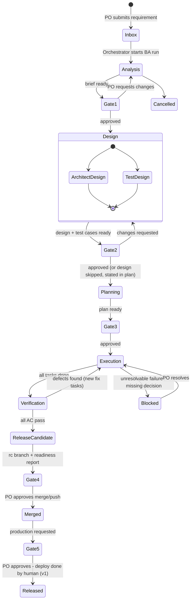
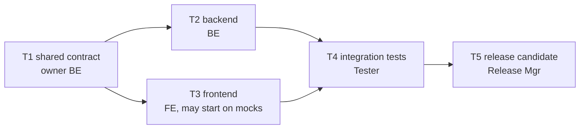
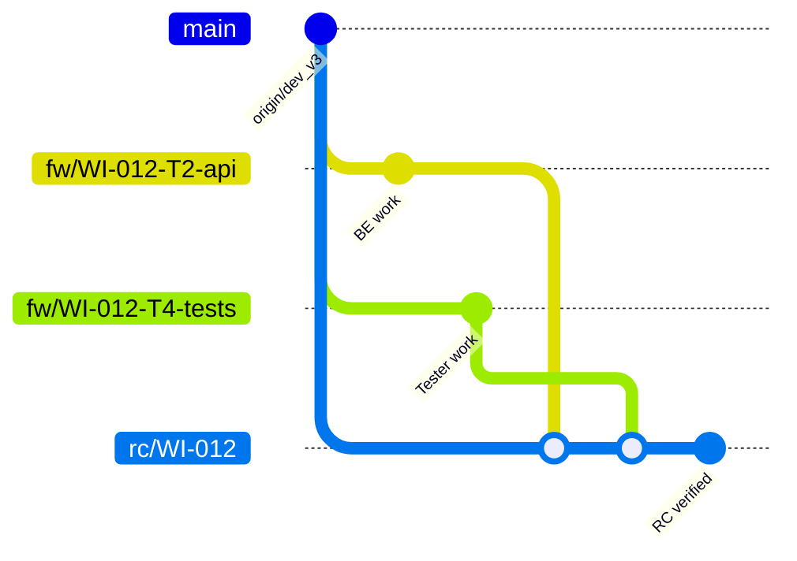

# 03 — Orchestrator and Workflow Engine

**Status:** ACCEPTED (gate 2, 2026-11-25). Roles are covered in doc 02, events and state tables in doc 05. Decisions: TD-07, TD-08.

**What each component does:**
- **Workflow Engine:** decides *what is allowed next* for a work item (stages and gates).
- **Orchestrator:** decides *what runs now* (the task graph, scheduling, retries, approval waits, resume).

Both are deterministic code. Neither makes an LLM call.

## 1. Work-item lifecycle
The lifecycle follows `agent-design.md` §1, with two additions:
- the Tester designs test cases right after gate 1;
- the Release Manager builds a release candidate.

- **Gates** are states that only an `approval.decided` event from the PO can leave (04 §3). No agent and no policy setting can move a work item past a gate.
- **Gate 5:** in v1 the Harness never deploys. Gate 5 records the PO's decision; the deployment itself is done by a human. Any future deploy adapter needs a new technical decision (TD) and explicit approval every time.
- **Early test design:** after gate 1 the Tester runs in parallel with the Architect. It writes `test-cases.md`, which maps each acceptance criterion (AC) to test cases. The PO reviews it at gate 2 together with the design.

## 2. Task graph and scheduling
`plan.md` (approved at gate 3) becomes a task DAG (05 §2). The Orchestrator parses it into rows with: ID, owner role, area, depends-on, and done criteria.

| Rule | Detail |
|---|---|
| Ready condition | Every `depends-on` task is `done`, and no open approval blocks the work item |
| Contract freeze | After the contract task's handoff is accepted, contract files are read-only for the rest of the work item (`agent-design.md` §2.3) |
| Concurrency limits | At most N runs in total, at most 1 run per task, and at most M runs per product repo. The defaults are small (e.g. N=2) because of cost. The values are OPEN (D15). |
| Order | Gate-unblocking work first, then the critical path, then FIFO |
| Cancellation | The PO can cancel a run or a work item. Running processes are killed (whole process tree) and the worktree is kept for inspection. |

## 3. Retries and failure handling
| Failure class | Examples | Handling |
|---|---|---|
| Transient provider error | 429, 5xx, network | Automatic retry with exponential backoff and jitter, up to the limit (e.g. 3). The same idempotency key is reused. |
| Tool error | A command exits non-zero, or a file isn't found | Returned to the agent as an error result. The agent decides what to do next. No automatic retry. |
| Repeated agent failure | The same tool error 3 times, a budget stop, or "no progress" in K turns | Run → `failed`, task → `blocked`, and the PO is notified with the last events |
| Policy denial | Write outside the worktree, or a secret path | Returned to the agent. 3 denials in one run → `blocked` (possible prompt injection) |
| Approval denied | The PO says no | The agent is told the action was denied. The run continues or ends, depending on the role. |
| Harness crash | Process killed | Resume (§6) |

## 4. Parallel development with git worktrees (TD-07)
| Item | Convention |
|---|---|
| Task branch | `fw/WI-NNN-Tn-<slug>`, created from the base ref in the adapter manifest (e.g. `origin/dev_v3`) |
| Worktree path | `.harness/worktrees/<repo>/<WI-NNN-Tn>/`. Never the PO's checkout. |
| Dependent task | Branches from its dependency's task branch, or from the base after that branch is integrated into the release candidate |
| Release candidate | The Release Manager creates `rc/WI-NNN` per repo, **locally**, and merges the task branches into it in dependency order. Conflicts → a fix task for the owning role. |
| Push / merge to shared branches | Gate 4 only. The PO's approval is bound to the exact branch and SHA. |
| Clean-up | After merge, or when the PO cancels. Clean-up of a worktree with uncommitted changes needs approval. |

In this diagram, `main` stands for the base ref, which is `dev_v3` in the products.

## 5. Verification
- **Determinism:** the Tester's runs call `verify` (doc 04, runtime), which runs the adapter's evidence commands.
- **What gets stored:** the results are keyed by `(repo, commit SHA, command id)` and reused while that SHA is unchanged. This avoids paying twice for the same build or test.
- **Regression:** a full suite run per repo on the `rc/*` SHA before gate 4.

## 6. Failure recovery and resume (TD-08)
1. **State is durable before it is acted on.** Every state change is an event written in the same SQLite transaction as the state-table update (05 §3). In-memory state can be rebuilt.
2. **On startup the Harness:**
   - marks runs that were `running` as `interrupted`;
   - kills processes it had recorded as owned and that are still alive;
   - re-attaches approvals that are still `waiting`.
3. **Resuming a run:**
   - rebuild the conversation from the run's events, then continue from the last completed step;
   - a tool call that has a `started` event but no `finished` event needs special handling:
     - idempotent tools (reads, verification) are run again;
     - for non-idempotent tools (writes, commands with side effects), the tool's `reconcile()` inspects the worktree state, such as `git status` and the file hash;
     - if reconciliation can't decide, the run goes to `blocked`.
4. **The PO decides** whether to resume interrupted runs, through the Approval Center. Nothing resumes automatically, so a crash loop can't burn budget.

## 7. Risks and trade-offs
| Risk | Mitigation |
|---|---|
| `plan.md` parsing is brittle | Planning outputs a structured task table that is validated against a schema in `packages/shared`. Invalid plan → back to the Architect. |
| Parallel runs cost more and can conflict | Small concurrency defaults, ownership-based write scopes, and conflicts resolved in the RC branch |
| An `interrupted` tool call can't be reconciled | `blocked` and handed to the PO. Accepted: exactly-once execution isn't guaranteed. |
| Two sources of truth: DB state vs. Markdown artifacts | The DB is the source of truth for state. Markdown files are the artifacts (content-hashed). ACCEPTED, D13 |
