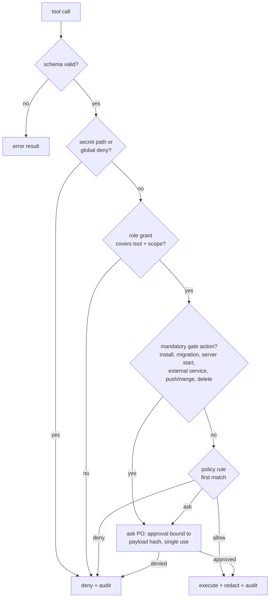

# 04 — Tool Runtime and Security

**Status:** ACCEPTED (gate 2, 2026-11-25). Builds on `docs/standards/security-policy.md`, which stays binding. Related decisions: TD-05, TD-07.

## 1. Tool Runtime responsibilities
- **Registry:** keeps the tools and their schemas (from `packages/shared`).
- **Validation:** checks every input against the tool's schema before it runs.
- **Permission check:** asks the policy engine for a decision (§3) on every call.
- **Execution:** runs the tool inside the run's scope (worktree, project).
- **Redaction:** cleans the output before it is stored or returned to a model (§4).
- **Process supervision:** argv only, no shell; Windows process trees are killed as a whole; ports are allocated; logs are captured (§5).
- **Audit events:** `tool.requested`, `tool.decided`, `tool.started`, `tool.finished` (05 §3).

```ts
// Illustrative shape (language per TD-01)
interface ToolDefinition<I, O> {
  name: string;                                   // "fs.read", "cmd.run", ...
  risk: "read" | "write" | "exec" | "network" | "destructive";
  idempotent: boolean;                            // drives resume behaviour (03 §6)
  input: Schema<I>;
  scope(input: I, ctx: RunContext): TargetScope;  // what policy evaluates: repo, paths, command id
  run(input: I, ctx: RunContext): Promise<O>;
  reconcile?(input: I, ctx: RunContext): Promise<"done" | "not_done" | "unknown">;
}
```

## 2. Tool catalog and least-privilege grants

| Tool | Risk | BA | Arch | BE | FE | Tester | RelMgr |
|---|---|---|---|---|---|---|---|
| `docs.read`, `fs.list`, `fs.read`, `search.text` | read | ✓ | ✓ | ✓ | ✓ | ✓ | ✓ |
| `git.log` / `show` / `diff` / `ls_tree` | read | ✓ | ✓ | ✓ | ✓ | ✓ | ✓ |
| `artifact.write` (own stage file only) | write | ✓ | ✓ | ✓ | ✓ | ✓ | ✓ |
| `fs.write` / `fs.edit` | write | — | — | own worktree | own worktree | test files in task worktree | — |
| `cmd.run` (adapter command ids) | exec | — | — | build/test/lint | build/test/lint | build/test/lint, e2e | build/test |
| `git.commit` (task branch) | write | — | — | ✓ | ✓ | ✓ | — |
| `git.merge` into local `rc/*` | write | — | — | — | — | — | ✓ |
| `git.push`, merge to shared branches | destructive | — | — | — | — | — | gate 4 only |
| `approval.request` (ask the PO) | — | ✓ | ✓ | ✓ | ✓ | ✓ | ✓ |

- **No raw shell in v1.** `cmd.run` accepts only the command ids declared in the project adapter (§5), with templated arguments.
- **Network tools:** none in v1, apart from the model provider calls made by the Agent Engine itself.

## 3. Permission engine (TD-05)



**Evaluation**
- Rules are checked in the order **deny → ask → allow**. Anything unknown is denied.

**Policy files**
- They live in `policy/*.yaml`, under version control.
- Agents can't write to them. Changes need the PO (`CLAUDE.md`).

**Approvals**
- An approval is bound to the SHA-256 of the exact action payload, for example the argv or the diff.
- It can be used once only.
- A changed payload needs a new approval.

**Defenses against prompt injection**
- Product files and tool outputs are data. Text in them never changes policy.
- Three denials in one run move the run to `blocked` (03 §3).

## 4. Secrets and redaction
| Control | Detail |
|---|---|
| Deny reads | Each adapter's `secretPaths`, merged with the global list from `security-policy.md` §1. This also applies to `git.show` and `git.diff` on those paths. |
| Redact outputs | Pattern-based: connection strings, `AccountKey=`, private key blocks, JWTs, known API-key prefixes, and high-entropy values next to password, secret, key or token names. The redactor runs before an output is persisted or sent to a model. |
| Env values | Loaded from `.harness/env/<profile>.env` (gitignored) and passed to child processes. Only the key names are logged. |
| Provider credentials | Read from the environment or the provider's CLI profile. Never stored in the database. |
| Residual risk | Redaction patterns can miss things. Rotating the secrets (D2, OPEN) is the real fix. |

## 5. Project adapters
`adapters/*.yaml` describes how the Harness may work with each managed product. Every value below comes from discovery (VERIFIED unless marked otherwise).

| Field | furwatch-api | furwatch-app |
|---|---|---|
| Source and base ref | `../furwatch-api` @ `dev_v3` | `../furwatch-app` @ `origin/dev_v3` (D1 ACCEPTED) |
| `build` | `dotnet build UrKnightAPI.sln` | `npm run build` |
| `test` | `dotnet test UrKnightAPI.sln`. INFERRED to have no side effects | `npx ng test --watch=false --browsers=ChromeHeadless`. UNKNOWN whether the specs compile |
| `lint` | none configured | `npm run lint` |
| `install` | `dotnet restore UrKnightAPI.sln` (ask) | `npm install --legacy-peer-deps` (ask; there is no lockfile) |
| `run` | **disabled** until D3 is resolved (§7) | `npm run dev` (ask), port 4200 |
| `health` | `GET /swagger/v1/swagger.json` (no health endpoint exists) | `GET /` |
| `secretPaths` | `**/appsettings*.json`, `**/ServiceAccounts/**`, `**/Keys/**`, `**/*.pubxml.user` | `**/google-services.json`, `**/GoogleService-Info*.plist`, `src/environments/**`, `src/index.html`, `src/firebase-messaging-sw.js` |
| `generated` (never edited) | `**/Migrations/*.Designer.cs`, `**/*ModelSnapshot.cs` | `android/**`, `ios/**`, `www/**`, `**/dist/**` |

## 6. Local API hardening
- The server binds to `127.0.0.1` only.
- Every request needs a random bearer token, created at each start. It is stored in `.harness/session` and injected into the page the server serves.
- The `Host` and `Origin` headers are checked against an allowlist. This blocks DNS rebinding and cross-site requests from other local web pages.

## 7. Product runtime isolation (TD-07; depends on D3)
- **What the Harness can do on its own:**
  - give each workspace its own LocalDB database, set through `Sqlconnection__ConnectionString` and `Hangfire__ConnectionString` overrides;
  - assign a Harness-owned port;
  - withhold real external credentials.
- **What it cannot do on its own:** stop the side effects that run on every startup (VERIFIED in `backend.md` §2 and §4):
  - Hangfire jobs that send push notifications and email;
  - seeding;
  - the Chromium download;
  - the Firebase service-account requirement.
- **Proposal:** these need a product work item that adds a local profile with no side effects. That decision is D3, still OPEN. Until then, the API's `run` command stays disabled, and M6 is blocked.

## 8. Risks and trade-offs
| Risk | Position |
|---|---|
| Denying `src/environments/**` blocks some legitimate FE tasks | Accepted until D2 moves the values out. Such tasks are marked `blocked`. |
| Allowlisting adapter commands limits what agents can do | That's intentional. New commands are added to the adapter through review. |
| Too many approval prompts ("approval fatigue") | Tune the allow rules for safe reads and verification in M3. The gate actions themselves can never be relaxed. |
| Redaction gives false confidence | The audit log keeps the redacted outputs, so the PO can review them. Rotate the secrets (D2). |
