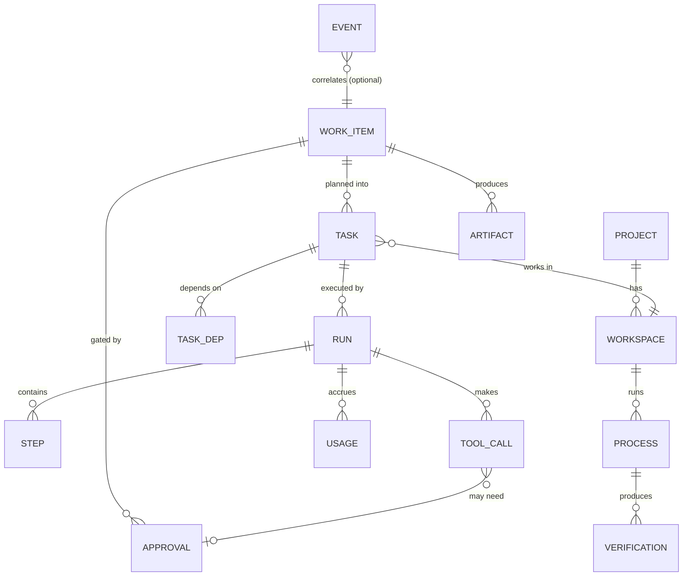
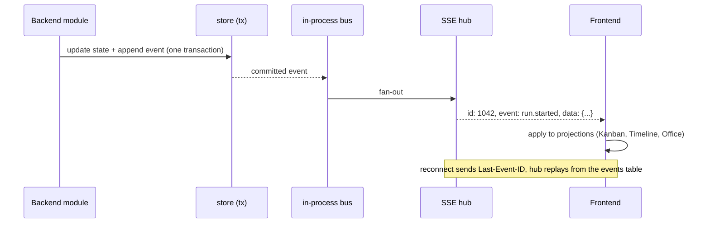

# 05 — Data Model and Events

**Status:** ACCEPTED (gate 2, 2026-11-25). The storage technology follows TD-01 (SQLite under `.harness/`), and the source-of-truth split follows D13 (ACCEPTED). The schemas live in `packages/shared` as contracts (TD-02).

## 1. Principles
- **State tables are for queries; the event log is the history.**
  - **State tables** hold the current state of work items, tasks, runs, approvals and processes.
  - **The event log** is append-only and records every change.
  - Both are written in **one transaction**, so they can't drift apart.
- **Not full event sourcing.** State is not rebuilt from events on every read. The event log is used for the audit trail, the UI streams, the Virtual Office, and run resume (03 §6). This keeps the system simple and fast on SQLite.
- **Markdown is the source of truth for artifacts; the database is the source of truth for workflow state** (D13, ACCEPTED).
  - The briefs, designs, plans and reports are Markdown in `docs/work-items/`, kept for human review and git history.
  - The database stores each artifact's path and content hash, and its approval refers to that hash.
- **No secrets and no environment values are stored**, only key names. Tool outputs are stored after redaction (04 §4).

## 2. Entities



| Table | Key fields |
|---|---|
| `projects` | id, name, path, adapter_id, base_ref |
| `work_items` | id (WI-NNN), title, stage (03 §1), status, created_by, created_at |
| `tasks` | id (WI-NNN-Tn), work_item_id, owner_role, area, status (`pending`, `ready`, `running`, `blocked`, `done`, `cancelled`), done_criteria |
| `task_deps` | task_id, depends_on_task_id |
| `workspaces` | id, project_id, task_id, branch, path, base_sha, head_sha, state |
| `runs` | id, task_id, role, provider, model, state (`queued`, `running`, `waiting_approval`, `interrupted`, `completed`, `failed`, `cancelled`), budget, started_at, ended_at |
| `steps` | run_id, seq, kind (`model_turn`, `tool_call`, `note`), payload_ref |
| `tool_calls` | id, run_id, seq, tool, args_redacted, scope, decision, rule_id, approval_id, status, exit_code, duration_ms |
| `approvals` | id, work_item_id, gate (1–5 or `action`), payload_hash, summary, state, decided_by, decided_at |
| `artifacts` | id, work_item_id, kind, path, content_hash, version |
| `usage` | run_id, seq, input_tokens, cached_input_tokens, output_tokens, cost |
| `processes` | id, workspace_id, command_id, argv, pid, port, state, log_path |
| `verifications` | repo, sha, command_id, result, summary, log_path (the cache key is repo + sha + command_id) |
| `events` | id (monotonic integer), ts, type, actor, work_item_id, task_id, run_id, correlation_id, causation_id, payload |

**Where large data lives:** model turns and raw logs are files under `.harness/runs/<run>/` and `.harness/logs/`. The tables hold only references to them.

## 3. Events

### 3.1 Envelope (defined in `packages/shared/events`)
```ts
interface HarnessEvent<T extends string, P> {
  id: number;             // monotonic; also the SSE id
  ts: string;             // ISO-8601
  type: T;                // e.g. "run.started"
  actor: "po" | "orchestrator" | "ba" | "architect" | "be" | "fe" | "tester" | "release" | "system";
  workItemId?: string; taskId?: string; runId?: string;
  correlationId: string;  // e.g. the work item
  causationId?: number;   // event that caused this one
  payload: P;             // schema per type; never secrets
}
```

### 3.2 Catalog (v1)

| Group | Types |
|---|---|
| Work item | `workitem.created`, `workitem.stage_changed`, `workitem.blocked`, `workitem.cancelled` |
| Gate / approval | `approval.requested`, `approval.decided` |
| Task | `task.created`, `task.ready`, `task.status_changed` |
| Run | `run.queued`, `run.started`, `run.turn_completed` (usage only, no content), `run.waiting_approval`, `run.interrupted`, `run.completed`, `run.failed` |
| Tool | `tool.requested`, `tool.decided` (allow/ask/deny + rule), `tool.started`, `tool.finished` |
| Workspace / git | `workspace.created`, `git.committed`, `rc.created`, `workspace.removed` |
| Process / verify | `process.started`, `process.exited`, `verify.completed` |
| Artifact | `artifact.written` (path + hash) |
| Budget | `budget.warning`, `budget.exceeded` |
| Agent presence | `agent.activity` (derived; see doc 06 §3) |

**Rules**
- Events are immutable and are never updated or deleted by application code.
- Adding a new event type, or changing a payload, is a **contract change** (`contracts.md` §1).

## 4. Delivery to the frontend


- There is one SSE stream per browser tab: `GET /api/events?since=<id>`. It can be filtered by work item.
- Snapshots are read from the state tables through HTTP. Live changes come through SSE. On reconnect, any gap is filled from the `events` table.

## 5. Retention and size
- **Event volume.** Most rows are `tool.*` and `run.turn_completed`. This is fine for SQLite at local scale. UNKNOWN until it's measured in M2.
- **Log and transcript files.** These are kept per run. Pruning old runs (keeping the events and dropping transcripts) is a PO setting. OPEN, D15.

## 6. Risks and trade-offs
| Risk | Position |
|---|---|
| State tables and events drift apart | Both are written in one transaction, through one `store` API |
| Artifacts are edited outside the Harness (in git) | The content hash changes, so the related approval no longer matches. The UI flags it for re-approval. |
| The event schema evolves | The envelope is versioned (`type` names are stable). New fields are optional only. |
| Single-writer SQLite contention | Transactions are short, and logs are written to files rather than the database |
