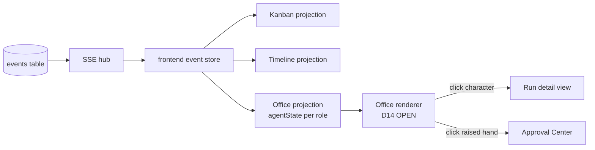
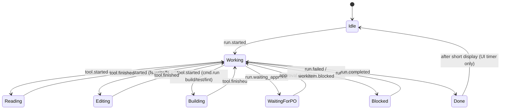

# 06 — Virtual Office Architecture

**Status:** ACCEPTED (gate 2, 2026-11-25). Rendering: DOM/SVG first (TD-11, D14 ACCEPTED).

## 1. Purpose and hard rule
The Virtual Office is a visual view of the team: one character per role, standing at a desk or a room. It shows who is working, waiting, blocked, or asking the PO for something.

**Hard rule:** the Virtual Office is a **pure projection of real events** (doc 05).
- It never triggers an LLM call.
- It never generates text, and it never has an agent "speak" to animate.
- Every bubble, status or movement can be traced to an event `id`.

## 2. Where it sits

- **Frontend only.** The office projection is client-side code in `apps/frontend/src/features/office/`. It reads the same event stream as the Kanban board and the Timeline.
- **No backend work.** It adds no endpoints, no tables and no LLM usage. It needs only one optional derived event, `agent.activity`; see §3.

## 3. Mapping events to agent states

| State | Visual (suggested) | Label text comes from |
|---|---|---|
| Idle | at desk, dimmed | — |
| Working | typing animation | `task.id` + title |
| Reading / Editing / Building | prop: book / pencil / gear | `tool.started` tool name + redacted scope (e.g. a file path) |
| WaitingForPO | raised hand, badge on the PO desk | `approval.requested.summary` |
| Blocked | red marker | `run.failed` / `workitem.blocked` reason |
| Done | check mark | `run.completed` |

- **Orchestrator:** shown as a "dispatcher" desk. It lights up on `task.ready` and `run.queued`.
- **PO desk:** shows the count of pending approvals.
- **Hand-offs:** a short "walk to desk" animation plays on `artifact.written` followed by the next stage's `run.started` for the same work item. It is driven purely by the order of those two events.
- **`agent.activity`:** this is an optional backend projection that combines the noisy `tool.*` events into one activity per run, at most one per second. It lowers frontend work on long runs. It is derived data, not a new source of truth.

## 4. Rendering (OPEN, D14)
| Option | Pros | Cons |
|---|---|---|
| A. DOM/SVG + CSS animations (recommended to start) | No extra dependency, accessible, easy to test with Playwright, low CPU | Limited to simple scenes |
| B. 2D canvas engine (e.g. a WebGL sprite library) | Richer scenes and sprites | New dependency, harder to make accessible, heavier |
| C. A list-only "office" (no graphics) | Cheapest | Doesn't meet the goal of a visual office |

**Recommendation: A.** Keep the renderer behind a small interface, so B can replace it later without touching the projection.

## 5. Performance and accessibility
- **Rendering cost:** coalesce updates to at most about 10 renders per second, and pause animation while the tab is hidden.
- **Reduced motion:** respect `prefers-reduced-motion`.
- **Text fallback:** a "list view" toggle shows the same state as text, for accessibility and for e2e assertions.
- **Rebuilding after reconnect:** replay recent events from the `events` table. The office has no local state worth persisting.

## 6. Risks and trade-offs
| Risk | Position |
|---|---|
| The office becomes a cost or performance sink | It is a projection only, so it has zero LLM cost. Rendering is throttled. |
| The visuals mislead the PO (they look busy while stuck) | States come from real events. "Blocked" and "WaitingForPO" are visually dominant. |
| Scope creep: chat with characters, AI-generated banter | Out of scope. It would need a requirement, approval at gate 1, and a cost decision. |
