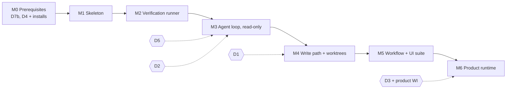

# 07 — Implementation Roadmap

**Status:** ACCEPTED as the plan (gate 2, 2026-11-25). Each phase still needs its own approvals; nothing starts without them. Each phase becomes a work item (WI) and goes through the normal gates (`agent-design.md` §1).

## 1. Blockers and dependencies

| Decision | Status | Blocks | Why |
|---|---|---|---|
| **D7b** Make `harness/` a git repository | ACCEPTED | **M1 and everything after it** | Code must be version-controlled. Task branches and worktrees need a repo. |
| **D4** Stack (TD-01) + install approval | Stack ACCEPTED · installs OPEN | **M1** | No root config and no code without the stack. Installing Node 24 and pnpm needs gate-4 approval. |
| **D2** Rotate the committed secrets and move them out of the repos | OPEN | Safe M3 (agents reading product code); FE edits to env files (04 §8) | The deny and redact rules reduce exposure but don't remove it |
| **D1** Authoritative `furwatch-app` branch | ACCEPTED (`origin/dev_v3`) | FE verification in M2; FE tasks in M4 | `frontend.md`: the source is only on `origin/dev_v3` |
| **D5** Providers + data policy | OPEN | **M3** | Product code would be sent to a model provider. No credentials are configured (VERIFIED). |
| **D3** Product change for a side-effect-free local profile | OPEN | **M6** | `backend.md` §2, §4 |
| D6, D10–D13 | ACCEPTED | M1–M3 as listed below | Design detail for those phases |
| D14 / D15 | D14 ACCEPTED · D15 values OPEN | M5 (Office), M3 (budgets) | Not needed earlier |

## 2. Phases

| Phase | Scope | Exit criteria (evidence) | Owners |
|---|---|---|---|
| **M0 Prerequisites** | Decide D7b and D4. Approve the installs: Node 24 LTS, pnpm via corepack. Pin versions. | Approvals recorded in `open-decisions.md` | PO, Orchestrator |
| **M1 Skeleton** | Root workspace config (TD-03). `packages/shared`: the error shape, the event envelope, health and project contracts. Backend: `store` + migrations, `events` + SSE, the project registry, read-only tools, the permission engine with secret-deny, the session token. Frontend: app shell, Projects view, Timeline (raw events). | Contract and e2e tests green. A test proves `fs.read` and `git.show` on a secret path are **denied** and audited. A lint rule blocks imports between the two apps. | BE, FE, Tester |
| **M2 Verification runner** | Adapter manifests, `runtime` (argv, process tree kill, logs), `cmd.run`, `verify` with a SHA cache, worktree creation from a ref | `furwatch-api` build and test runs in a worktree from the UI, with live logs and a stored verdict. FE only if D1 is resolved. | BE, FE, Tester |
| **M3 Agent loop (read-only)** | Provider port + first adapter + fake provider, the context builder, budgets, the Approval Center, run detail, the Requirement Inbox → BA run | A BA run turns an inbox item into `brief.md` with `path:line` citations. Every tool call is audited. The budget stop is tested with the fake provider. | BE, FE, Tester |
| **M4 Write path** | `fs.write`/`fs.edit` in worktrees, `git.commit`, the diff view, task reports. The Orchestrator task DAG for single-repo tasks. | A BE run makes a small approved change with build and test evidence. Nothing is pushed. | BE, FE, Tester |
| **M5 Workflow + UI suite** | The full work-item state machine and gates (03 §1), early test design, parallel tasks, the RC branch, the Kanban board, the agent dashboard, the Virtual Office (D14), crash resume | One work item goes from inbox to gate 4 with every gate in the Approval Center. Kill-and-resume is tested. | BE, FE, Tester, Release Manager |
| **M6 Product runtime** | Isolated product servers, health probes, API checks | `furwatch-api` runs against LocalDB with no external side effects | Blocked on D3 |

## 3. Recommended next phase
**M0, then M1.** M1 delivers the safety backbone before any model is connected:
- the event store;
- the permission engine;
- secret denial;
- contract tests.

That keeps M1 cheap. It makes no LLM calls and doesn't need D5.

## 4. Risks
| Risk | Mitigation |
|---|---|
| The blockers (D1, D2, D5) stay open and stall M3/M4 | M1–M2 don't depend on them. Escalate them through `/fw:status`. |
| Scope creep in the UI suite (Office, Kanban) | These are M5 items only. M1–M4 use plain views. |
| The SQLite native driver fails on Windows | UNKNOWN. Try it first in M1. The fallback is listed in TD-01. |
